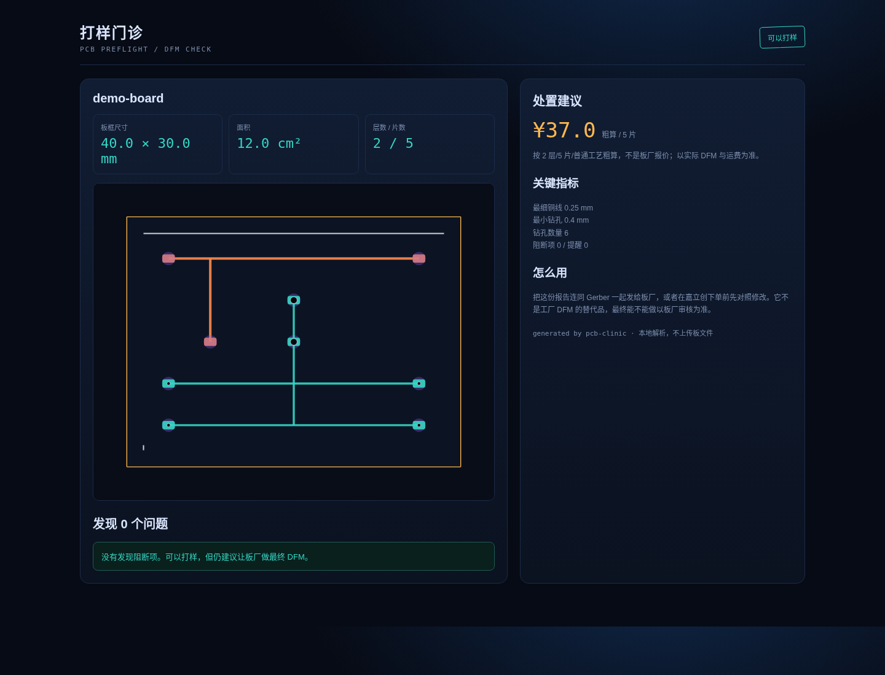

# 打样门诊 · PCB 预审

> 上传 Gerber，先体检再花钱。错误直接标在板图上，不是一句“建议检查设计”。

DIY 打样最贵的不是板费，是打完才发现板框没闭合、丝印压焊盘、最小孔 0.2 mm。打样门诊在本地解析 Gerber / Excellon，跑一组能定位的 DFM 规则，生成一份带板图预览的 HTML 报告。



## 现在能查什么

| 检查 | 级别 | 说明 |
| --- | --- | --- |
| 板框闭合 | 阻断 | 端点连接数必须为偶数；断开的轮廓直接标红 |
| 缺少层 | 阻断 | 双面板要求 Edge_Cuts / F_Cu / B_Cu / F_Mask / B_Mask |
| 最细铜线 | 提醒 | 低于 0.15 mm 标黄，给出实际值 |
| 最小钻孔 | 提醒 | 低于 0.30 mm 标黄 |
| 焊盘出界 | 提醒 | 焊盘外形超出板框 |
| 焊盘离边太近 | 提醒 | 边距低于 0.20 mm |
| 丝印压焊盘 | 提示 | 丝印线段与焊盘包围盒相交，标“疑似” |
| 阻焊缺失 | 提醒 | 双面板缺 F_Mask / B_Mask |

报告包含板框尺寸、面积、层数、片数、最细线/最小孔、阻断项、提醒项，以及一个**粗算价格**（明确标注不是板厂报价）。

## 跑起来

```bash
python -m pcb_clinic check examples/demo-board --out demo-report.html
```

也可以直接吃 zip：

```bash
python -m pcb_clinic check board.zip --layers 2 --qty 5 --out report.html --json
```

终端输出：

```
结论：可以打样
尺寸：40.0 × 30.0 mm / 面积 12.0 cm²
问题：阻断 0 / 提醒 0
粗算：¥37.0（5 片，非报价）
报告：/path/to/report.html
```

## 示例板

`examples/demo-board/` 是一块 40 × 30 mm 的 2 层板，完全用 RS-274X / Excellon 文本生成，不依赖 KiCad：

- 4 条闭合板框
- F_Cu / B_Cu 走线与焊盘
- F_Mask / B_Mask
- F_Silkscreen
- 6 个钻孔（0.4 / 0.8 mm）

重新生成：

```bash
python examples/make_demo.py
```

## 结构

```
pcb_clinic/
  gerber.py    # RS-274X：DRAW / FLASH / REGION、常见光圈
  excellon.py  # 钻孔文件
  board.py     # 目录/zip 装载与层名识别
  rules.py     # DFM 规则、评分、粗算报价
  report.py    # SVG 板图 + HTML 报告
tests/         # 7 项测试
```

## 边界（重要）

- **不是完整 Gerber 规范**：圆弧按直线近似，不支持宏光圈（AM）、复杂孔环/阻抗/叠层。遇到不支持的内容会记录解析提醒，不会假装看懂。
- **不是板厂 DFM**：最终能不能做、多少钱，以嘉立创等板厂审核为准。这里的价格是面积/层数/片数的粗算，不含运费、加急、特殊工艺。
- **规则是工程经验值**：0.15 mm 线宽、0.30 mm 钻孔是常见档位，不同板厂/工艺不同；可按自己的工艺改 `rules.py` 顶部常量。
- **不渲染成专业 3D**：SVG 是 2D 预览，用来定位问题，不替代 CAM 软件。

## Roadmap

- [ ] 支持 KiCad `.kicad_pcb` 直接读取，不用先导 Gerber
- [ ] 真正的间距/环宽检查（需要多边形布尔运算）
- [ ] 拼板与工艺边检查
- [ ] 嘉立创/捷配价格档位配置化
- [ ] 批量对比：同一块板不同版本，谁更接近能打

## License

MIT
